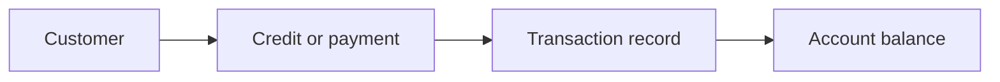

# Carnet Hanoty — Merchant Credit Record App

**Project stage:** Development | **Repository:** Private | **Area:** Mobile business tools

[Back to portfolio](../README.md)

## User problem
Small merchants need simple customer credit records and clear transaction histories.

## Core workflow

This is a conceptual view, not a statement that every planned feature has shipped.

## Engineering focus
- Customer and transaction workflows
- Consistent records and understandable account balances
- Backup and recovery design
- Validation when restoring stored information
- Practical phone-first user experience

## What it demonstrates
Business workflow modeling, mobile product development, data integrity considerations and usability-focused implementation.

No customer records or private source code are included. Real screenshots can be added after using synthetic sample data. See [media checklist](../SHOWCASE_ASSETS.md).
