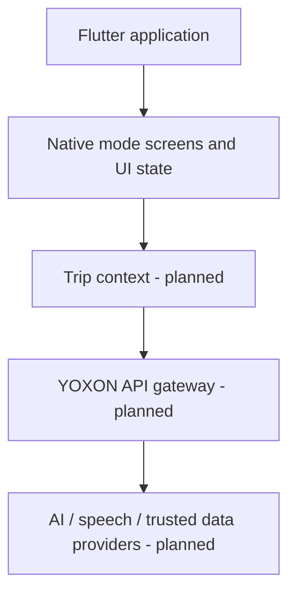

# Morocco Mode — Flutter Travel Experience

**Role:** Flutter app development and product design · **Stage:** M0 feasibility / pre-alpha · **Source code:** Private  
**Verified stack:** Flutter, Dart, Cupertino icons, Flutter test/lints

[← Back to portfolio](../README.md)

## The problem

Travelers need easy-to-navigate, localized information while moving between unfamiliar places and languages. Morocco Mode explores a task-driven mobile experience for Morocco.

## Current development focus

- Flutter Android shell and responsive interface structure.
- Scroll-synchronized hero experience alongside native Flutter service cards.
- Emulator-based navigation and visual QA.
- Frame smoothness, readability, cropping and clipping during scrolling.
- Future multilingual and contextual assistant features planned behind replaceable API/provider boundaries.

## Architecture direction

*Only the Flutter UI work is presented as active implementation. The gateways and external services are architecture direction, not confirmed launched integrations.*

## Engineering decisions

1. Use native Flutter widgets for core interactions and service cards.
2. Profile scroll animation separately from navigation and layout work.
3. Keep provider-specific services outside the UI so integrations can evolve.
4. Design safety-relevant travel answers around verified sources rather than generated guesses.

## What this demonstrates

Flutter/Dart engineering, mobile animation integration, responsive layouts, emulator testing and performance investigation.

**Status note:** Pre-alpha; not represented as a live travel service.

**Contact:** [admin@yoxon.co](mailto:admin@yoxon.co)
