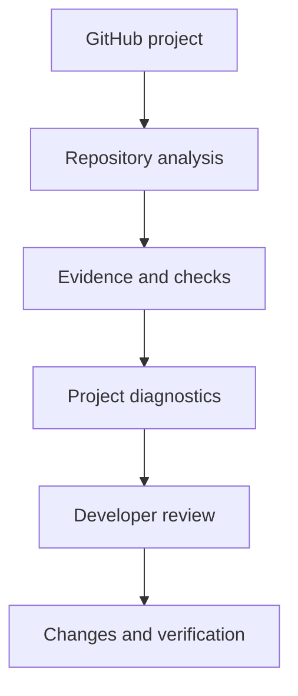

# ViberCodify — AI Software Delivery Intelligence

**Role:** Product owner and full-stack development · **Stage:** Development · **Source code:** Private  
**Areas:** Next.js, React, TypeScript, PostgreSQL, Drizzle ORM, GitHub workflows, testing

[← Back to portfolio](../README.md)

## The problem

AI coding assistants help teams write software quickly, but generated work still needs human review, security checks, test coverage, and deployment validation. ViberCodify explores a workflow for making those checks easier to understand and act on.

## Technical approach

The repository contains a Next.js/React/TypeScript application, PostgreSQL tooling through Drizzle and Neon, and commands for automated checks. Its package scripts include **type checking**, **linting**, **Vitest**, **Playwright**, and **production builds**.

*The diagram summarizes the intended analysis workflow; it does not assert that every stage is deployed.*

## Engineering challenges

- **Trustworthy evidence:** separate deterministic checks from LLM-generated explanations and proposals.
- **Persistent context:** model project state and remembered findings without treating summaries as source-of-truth.
- **Release confidence:** combine type checking, unit and end-to-end testing, and deployment checks.
- **Provider flexibility:** design AI integrations so the application is not tied to a single model provider.

## Evidence and implementation

- Verified repository technologies: **Next.js 16, React 19, TypeScript 5, Drizzle ORM, Neon PostgreSQL**.
- Present development scripts: `build`, `lint`, `typecheck`, `test`, `test:e2e`, and database schema tooling.
- The public case study does **not** disclose the private application code, claim public test coverage numbers, or represent planned product functions as shipped.

## What this demonstrates

Full-stack TypeScript development, developer tooling, data design, CI/testing practices, and engineering trade-offs around AI-assisted software delivery.

**Contact:** [admin@yoxon.co](mailto:admin@yoxon.co)
