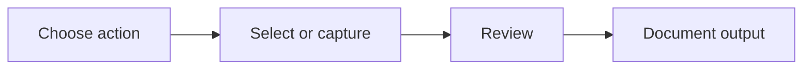

# YOXON Scanner — Mobile Document Workflows

**Project stage:** In development | **Repository:** Private | **Area:** Android UI and document handling

[Back to portfolio](../README.md)

## Problem and approach
Mobile document tasks need clear controls, understandable selection states and readable layouts. This project explores a streamlined Android experience for scanning and PDF workflows.

## UI workflow

The diagram describes the product workflow rather than release status.

## Engineering work
- Screen layout, visual hierarchy and action selection
- Immediate feedback on selected document operations
- Android-oriented navigation and usability review
- PDF-related interactions and document organization
- Multilingual UI considerations

## Engineering decisions
Keep core actions visible. Use a consistent selected state. Check text readability and navigation during emulator and screenshot reviews.

**What it demonstrates:** Mobile interface development, UX debugging and document workflow design.

Screenshots will be added after authentic app captures are checked for private content. See [media checklist](../SHOWCASE_ASSETS.md).
